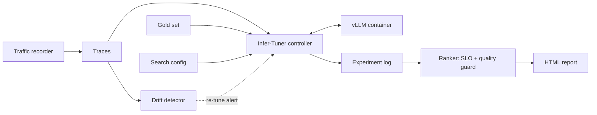
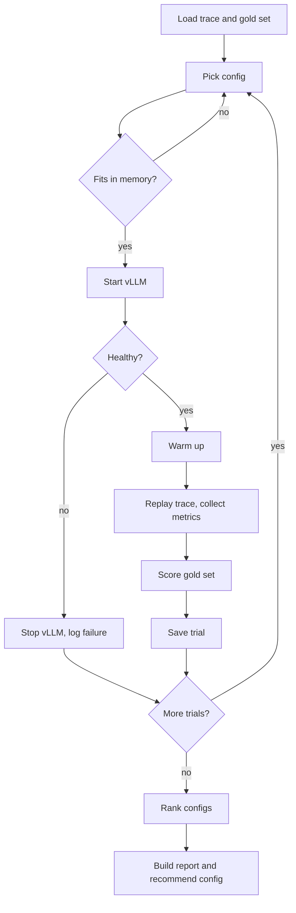

# Infer-Tuner

Find the best inference settings for a self-hosted LLM, tested on your own traffic, without lowering answer quality.

> **Status:** planning complete, implementation starting. The modules and commands below describe the planned design and don't exist yet.

## The problem

Teams that self-host LLMs often run their inference server on default settings. Those defaults don't match real traffic, so:

- answers slow down at peak, when the KV cache fills up and requests queue or get preempted
- GPUs sit idle off-peak but are still paid for
- teams may buy more GPUs when the real issue is configuration
- faster quantized models get adopted without checking whether answers are still correct

Settings such as `max-num-seqs`, `max-num-batched-tokens` and `gpu-memory-utilization` interact, and the best values depend on the workload. Testing them by hand is slow, and the result goes stale as traffic changes.

## What Infer-Tuner does

Infer-Tuner closes the loop that one-off benchmarks and tuners leave open:

1. **Record** traffic shape: arrival times, token counts and prefix hashes, never prompt text.
2. **Replay** that traffic against a test vLLM server.
3. **Tune** engine settings automatically.
4. **Guard quality** by rejecting configs that lose accuracy on a domain gold set.
5. **Report** the winning config, GPUs needed and estimated cost.
6. **Watch for drift** and suggest re-tuning when traffic changes.

## Architecture

A Python controller restarts one vLLM Docker container for each config it tests. Only one vLLM server runs at a time, so tests don't disturb each other.



### Tuning flow



## Planned repository layout

```text
configs/      Search spaces, SLO targets and GPU prices
traces/       Synthetic and recorded traces (JSONL)
goldsets/     Quality questions with expected answers
infertune/
  engine/     Start, stop and health-check vLLM
  replay/     Trace generator and replay client
  metrics/    Latency, goodput and GPU metrics
  search/     Grid and Optuna search, ranker
  quality/    Gold set scoring
  report/     Cost model and HTML report
  recorder/   Metadata-only traffic capture
  drift/      Traffic drift detection
experiments/  One folder per tuning run
tests/
docs/
```

## Planned commands

```bash
infertune baseline --config configs/search.yaml
infertune tune --config configs/search.yaml
infertune report --job <job_id>
infertune drift --base traces/tuned.jsonl --new traces/recent.jsonl
```

## POC scope

- **Hardware:** one NVIDIA DGX Spark
- **Engine:** vLLM
- **Model:** one 7–8B open model, proposed Llama 3.1 8B
- **Traffic:** synthetic and public traces, plus the metadata-only recorder

Multi-node clusters, Kubernetes, autoscaling and automatic changes to production servers are out of scope. Infer-Tuner only recommends a config, and the team applies it.

Results compare tuned and default settings on the same machine. Speeds measured on a DGX Spark don't predict speeds on datacenter GPUs.

## Roadmap

| Phase | Goal |
| --- | --- |
| 1. Foundation | Serve the model on the DGX Spark, replay traces, record baseline metrics |
| 2. Tuner and quality guard | Automatic config search, gold set scoring, ranking |
| 3. Report, drift and deploy | Cost report, drift alert, deployed demo |
